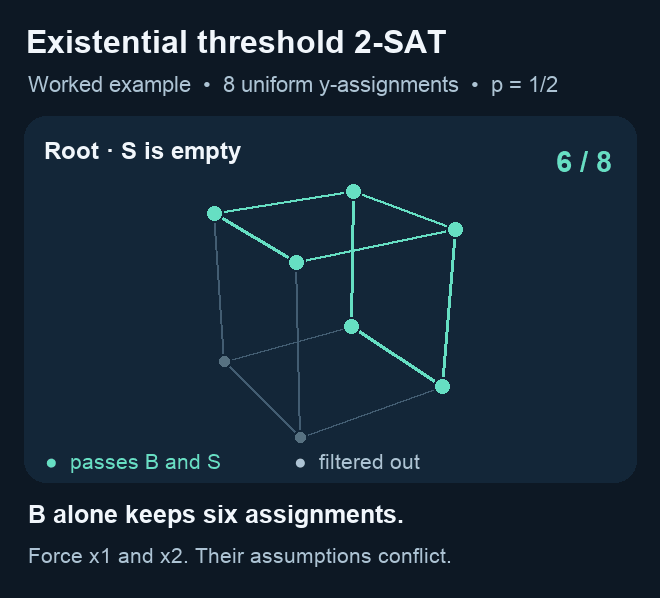

# Existential probability thresholds for 2-CNF

A 2-CNF has two blocks of variables, $x$ and $y$. Can we fix $x$ so that at least a $p$-fraction of the uniform assignments to $y$ satisfy the formula?

**Result.** The decision and witness search take $O((1/p)^c|\varphi|)$ word operations for $c=1+2/\log_2(4/3)<5.82$, given the integer cutoff $N=\lceil 2^{|y|}p\rceil$. This answers Open Problem 3 in Akmal’s thesis in the exact count-threshold model. Reading and converting a separately encoded rational has its own cost.

[Paper PDF](paper/manuscript.pdf) · [LaTeX source](paper/manuscript.tex) · [Original Catalog Q74](https://github.com/10m-u/open-problems-catalog/blob/ca8d4d44ba3db527f19f28928c240168f545ecfe/problems/computer_science_ai/theory-of-computation-algorithms-part-1.md#q74) · [Akmal’s Open Problem 3](https://www.shyanakmal.com/publications/ShyanAkmal_PhD-Thesis.pdf#page=92)

## Watch one conflict become two branches

Each vertex is one assignment to $y_1,y_2,y_3$. At the root the two mixed clauses force incompatible $x$-assumptions. Allowing $y_1$ gives a witness with four surviving assignments. The sibling that allows $y_2$ has only three. The figure shows one exact example of the general argument.

[Download the offline explorer ZIP](visualization/existential-threshold-2sat-explorer.zip?raw=1) · [Rendering source and worked example](visualization/README.md)

## Proof idea

Split the clauses into $x$-only, $y$-only and mixed clauses. Once $x$ is fixed, each mixed clause is satisfied or forces a $y$-literal. Forcing $k$ consistent distinct literals leaves at most $2^{-k}$ of the assignments. Each branch therefore spends one unit of a budget of at most $\lfloor\log_2(1/p)\rfloor$.

When the desired $x$-units are inconsistent, two implication paths identify one or two source units that cause the conflict. A valid branch must release at least one corresponding $y$-label. At each node, compute the exact $y$-count using the small variable cover of a disjoint clause family.

Akmal and Williams already use this counting technique. Standard grouped feasibility and enumeration give a route to ordinary fixed-parameter tractability with a polynomial formula factor. The on-demand conflict search gives the linear formula factor asked for in the thesis. See the [literature check](audits/public_safe_reports/LITERATURE_AUDIT.md).

## Replay and review

The Python replay cross-checks 1,603,370 exact formula–threshold pairs against direct enumeration, checks every returned witness, and replays the pictured example. [Run the replay](REPRODUCIBILITY.md) · [Review status](STATUS.md) · [Claim and encoding scope](CLAIM_SCOPE_AND_LIMITATIONS.md)

DannyExperiments is the preferred citation identity. [AI disclosure](AI_DISCLOSURE.md) · [Citation metadata](CITATION.cff)
